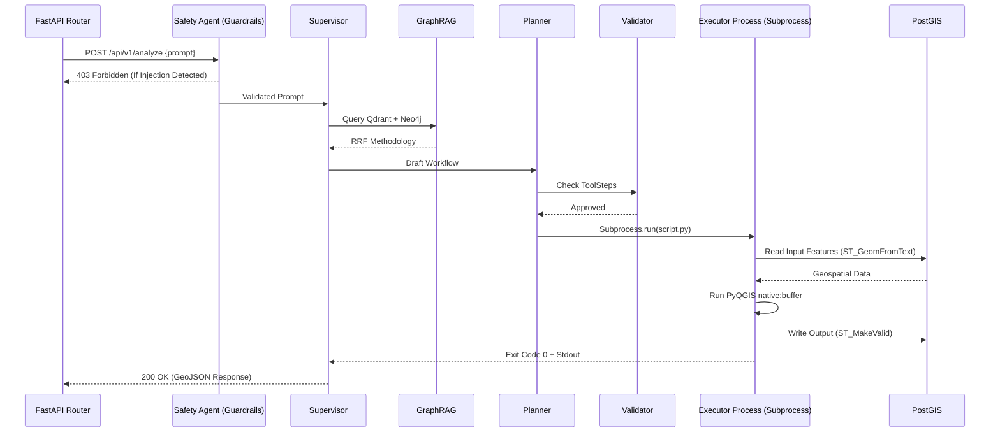

# GeoSI Module Connections & Detailed Data Flow Specification

## Table of Contents
1. [Introduction & Philosophy](#introduction)
2. [High-Level Data Flow Topology](#high-level)
3. [Agent Inter-Process Communication (IPC) JSON Schemas](#ipc-schemas)
4. [The MCP Bridge: FastMCP Integration](#mcp-bridge)
5. [GraphRAG Connections & Reciprocal Rank Fusion](#graphrag-connections)
6. [Database Connection Lifecycle (PostGIS, Neo4j, Qdrant)](#db-connections)
7. [Execution State Machine & Handshake Protocols](#state-machine)
8. [Error Handling, Rollbacks, and Fallbacks](#error-handling)
9. [Detailed Sequence Diagrams](#sequence-diagrams)
10. [API Endpoint Specifications](#api-specs)

## 1. Introduction & Philosophy <a name="introduction"></a>
The GeoSI platform operates on a strictly decoupled, event-driven architecture. Modules do not call each other's functions directly in memory; instead, they pass strictly validated JSON state objects through a central orchestrator. This design prevents memory leaks during heavy C++ GIS computations and allows the Python garbage collector to clean up geographic dataframes immediately after a state transition.

## 2. High-Level Data Flow Topology <a name="high-level"></a>

The physical file connections in the repository represent a directed acyclic graph (DAG) of dependencies:

*   `geosi_engine/agents/supervisor.py` imports `planning.py`, `research.py`, `validation.py`, `code_generation.py`, `verification.py`, and `report_generation.py`.
*   `geosi_rag/rag_service.py` is isolated and only imported by `research.py` (The GraphRAG Agent).
*   `geosi_mcp/server.py` sits completely above the engine. It imports `supervisor.py` but the engine is entirely unaware of the MCP server.
*   `geosi_engine/guardrails.py` intercepts raw string input before the FastAPI router or MCP server even attempts to parse it into JSON.

## 3. Agent Inter-Process Communication (IPC) JSON Schemas <a name="ipc-schemas"></a>

When Agent A talks to Agent B, they pass a `GeoSIState` object. Here is the strict JSON schema defining those connections:

```json
{
  "$schema": "http://json-schema.org/draft-07/schema#",
  "title": "GeoSI State Passing Schema",
  "type": "object",
  "properties": {
    "request_id": {
      "type": "string",
      "description": "UUID for tracing via OpenTelemetry"
    },
    "original_prompt": {
      "type": "string"
    },
    "current_agent": {
      "type": "string",
      "enum": ["Supervisor", "Planner", "Validator", "Executor", "Verifier", "Reporter"]
    },
    "gis_context": {
      "type": "object",
      "properties": {
        "input_layers": {
          "type": "array",
          "items": {
            "type": "object",
            "properties": {
              "layer_name": {"type": "string"},
              "crs": {"type": "string", "default": "EPSG:4326"},
              "geometry_type": {"type": "string"},
              "filepath": {"type": "string"}
            },
            "required": ["layer_name", "filepath"]
          }
        },
        "spatial_extent": {
          "type": "array",
          "description": "[minx, miny, maxx, maxy]",
          "items": {"type": "number"},
          "minItems": 4,
          "maxItems": 4
        }
      }
    },
    "execution_plan": {
      "type": "array",
      "items": {
        "type": "object",
        "properties": {
          "step_id": {"type": "integer"},
          "tool_name": {"type": "string"},
          "parameters": {"type": "object"},
          "expected_output": {"type": "string"}
        },
        "required": ["step_id", "tool_name", "parameters"]
      }
    },
    "execution_results": {
      "type": "object",
      "properties": {
        "success": {"type": "boolean"},
        "output_files": {
          "type": "array",
          "items": {"type": "string"}
        },
        "stdout": {"type": "string"},
        "stderr": {"type": "string"}
      }
    },
    "verification_status": {
      "type": "object",
      "properties": {
        "passed": {"type": "boolean"},
        "errors": {
          "type": "array",
          "items": {"type": "string"}
        }
      }
    }
  },
  "required": ["request_id", "original_prompt", "current_agent"]
}
```

## 4. The MCP Bridge: FastMCP Integration <a name="mcp-bridge"></a>

The connection to Claude Desktop is managed via `fastmcp`. FastMCP establishes a JSON-RPC 2.0 connection over `stdio`. 

### MCP Tool Registration Mapping
| MCP Tool Name | Internal GeoSI Connection | Description |
| :--- | :--- | :--- |
| `geosi_analyze` | `supervisor.invoke(state)` | The primary entrypoint for full autonomous workflows. |
| `geosi_rag_search` | `research.py -> rag_service.py` | Direct access to the Qdrant/Neo4j knowledge base. |
| `geosi_validate_crs` | `verification.py -> verify_crs()` | Headless fiona CRS validation without executing a full workflow. |
| `geosi_fetch_wfs` | `research.py -> fetch_wfs()` | Connects to external web feature services. |

### MCP Connection Lifecycle
1. **Initialize**: Claude Desktop spawns the `geosi_mcp/server.py` process.
2. **Handshake**: The server returns the supported tools (listed above) and supported resources (e.g., local shapefile directories).
3. **Execution**: Claude calls a tool via JSON-RPC. The `server.py` wrapper maps the JSON-RPC payload to the `GeoSIState` Pydantic model and injects it into the `supervisor.py`.
4. **Yield**: The engine runs asynchronously. The MCP server yields progress updates back to Claude Desktop using `server.progress()` callbacks.
5. **Completion**: The final GeoJSON or Markdown report is serialized back through stdout to Claude.

## 5. GraphRAG Connections & Reciprocal Rank Fusion <a name="graphrag-connections"></a>

The `geosi_rag` module connects three discrete systems:

1.  **The LLM Embedder**: Uses `sentence-transformers` (e.g., `all-MiniLM-L6-v2`) to convert queries into 384-dimensional dense vectors.
2.  **Qdrant Vector DB**: Connected via gRPC on port 6334. Stores the dense vectors of chunked GIS manuals.
3.  **Neo4j Graph DB**: Connected via Bolt protocol on port 7687. Stores relationships like `(UserQuery)-[:SIMILAR_TO]->(HistoricalWorkflow)-[:USED_TOOL]->(native:buffer)`.

### The RRF Connection Algorithm
When `research.py` requests knowledge:
1.  **Thread A** queries Qdrant. Returns top $K=60$ documents ranked by cosine similarity.
2.  **Thread B** queries Neo4j. Returns top $K=60$ structural nodes ranked by PageRank centrality relative to the query entities.
3.  **The Fusion**: `rag_service.py` merges the lists using Reciprocal Rank Fusion:
    $$ RRF\_Score(d) = \sum_{r \in R} \frac{1}{k + r(d)} $$
    where $k=60$, and $r(d)$ is the rank of document $d$ in the retrieved list $R$.

## 6. Database Connection Lifecycle <a name="db-connections"></a>

Connections to the data layer are managed with strict lifecycle rules to prevent socket exhaustion and zombie processes.

### PostGIS (Execution Layer Data)
*   **Connection Pooling**: Managed by `sqlalchemy` with `psycopg2-binary`.
*   **Pool Size**: 20 connections, max overflow 10.
*   **Lifecycle**: The `gis_agent.py` requests a session via a context manager (`with get_db() as db:`). The session is strictly closed at the end of the agent's turn. Long-running GDAL operations DO NOT hold the database lock; they write to temporary `.gpkg` files, and a bulk `COPY` command pushes the final result to PostGIS post-execution.

### Neo4j (Knowledge Graph)
*   **Driver**: `neo4j.GraphDatabase.driver`.
*   **Lifecycle**: Singleton pattern initialized on server startup. The `graph_writer.py` maintains a persistent session.

### Redis (Pub/Sub & Cache)
*   **Driver**: `redis.asyncio.Redis`.
*   **Lifecycle**: Used for the Real-Time Streaming Agent and Supervisor state caching. Connections are pulled from a dynamic connection pool.

## 7. Execution State Machine & Handshake Protocols <a name="state-machine"></a>

The connections between the 14 agents are governed by a strict state machine. An agent cannot connect to another agent without the Supervisor's authorization.

### State Transitions
*   `START` $\rightarrow$ `SAFETY_CHECK` (Handled by `permission_safety.py`)
*   `SAFETY_CHECK` $\rightarrow$ `ROUTER` (Handled by `reflection.py`)
*   `ROUTER` $\rightarrow$ `SUPERVISOR`
*   `SUPERVISOR` $\rightarrow$ `RESEARCH` (If methodology unknown)
*   `SUPERVISOR` $\rightarrow$ `PLANNER` (If methodology known)
*   `PLANNER` $\rightarrow$ `VALIDATOR`
*   `VALIDATOR` $\rightarrow$ `PLANNER` (If validation fails)
*   `VALIDATOR` $\rightarrow$ `EXECUTOR` (If validation passes)
*   `EXECUTOR` $\rightarrow$ `INTERPRETER` (If Python exception caught)
*   `INTERPRETER` $\rightarrow$ `EXECUTOR` (Retrying with fixed code)
*   `EXECUTOR` $\rightarrow$ `VERIFIER` (If execution completes)
*   `VERIFIER` $\rightarrow$ `EXECUTOR` (If QA fails, e.g., missing CRS)
*   `VERIFIER` $\rightarrow$ `REPORTER` (If QA passes)
*   `REPORTER` $\rightarrow$ `END`

## 8. Error Handling, Rollbacks, and Fallbacks <a name="error-handling"></a>

Because GeoSI connects to fragile C++ GIS libraries, error handling across connections is paramount.

### The GDAL/QGIS Fault Boundary
If `code_generation.py` executes a script that causes a GDAL segmentation fault, it will kill the Python process.
**Connection Safeguard**: The Executor Agent runs the generated PyQGIS code in a completely isolated subprocess using `subprocess.Popen`. 
*   If the subprocess crashes, the main FastAPI/Supervisor process survives.
*   The Executor captures the `stderr` and exit code.
*   The Executor passes the stack trace to the `Interpreter Agent` to rewrite the script and try again (up to `MAX_RETRIES=3`).

### The Database Rollback Connection
If a spatial operation successfully creates 5 out of 6 required tables in PostGIS and then fails:
*   The `Verification Agent` detects the failure.
*   It emits a `ROLLBACK` event.
*   The `gis_agent.py` catches the rollback event, connects to PostGIS, and drops the 5 orphaned tables to maintain database atomicity.

## 9. Detailed Sequence Diagrams <a name="sequence-diagrams"></a>



## 10. API Endpoint Specifications <a name="api-specs"></a>

Below is the OpenAPI 3.0 YAML specification for the connections exposed by the FastAPI server to local frontends:

```yaml
openapi: 3.0.0
info:
  title: GeoSI Autonomous Agent API
  version: 2.0.0
paths:
  /api/v1/analyze:
    post:
      summary: Triggers the full 14-agent autonomous pipeline.
      requestBody:
        required: true
        content:
          application/json:
            schema:
              type: object
              properties:
                prompt:
                  type: string
                  example: "Calculate the NDVI for the given Sentinel-2 images and find areas below 0.2."
                aoi_geojson:
                  type: object
                  description: Optional Area of Interest boundary.
      responses:
        '200':
          description: Successful execution. Returns the final report and output GeoJSON.
          content:
            application/json:
              schema:
                type: object
                properties:
                  report:
                    type: string
                  output_layers:
                    type: array
                    items:
                      type: string
                      description: URLs or GeoJSON feature collections.
        '400':
          description: Validation Error (e.g., missing input files).
        '403':
          description: Guardrail Block (Prompt Injection Detected).
        '500':
          description: Execution Failure (Max retries exceeded by Interpreter Agent).
  /api/v1/knowledge/ingest:
    post:
      summary: Uploads a PDF or Markdown manual to the GraphRAG Engine.
      requestBody:
        content:
          multipart/form-data:
            schema:
              type: object
              properties:
                file:
                  type: string
                  format: binary
      responses:
        '202':
          description: File accepted for chunking and embedding.
  /api/v1/health:
    get:
      summary: Checks connections to all external data layers.
      responses:
        '200':
          description: Returns status of PostGIS, Qdrant, Neo4j, and Ollama.
```

## Summary
The connections within GeoSI are fundamentally built around fault tolerance. By wrapping unstable GIS operations in isolated subprocesses, validating data strictly via Pydantic/JSON schemas, and utilizing a rigid Agentic State Machine, the platform guarantees that complex spatial mathematics can be automated safely and reliably.
